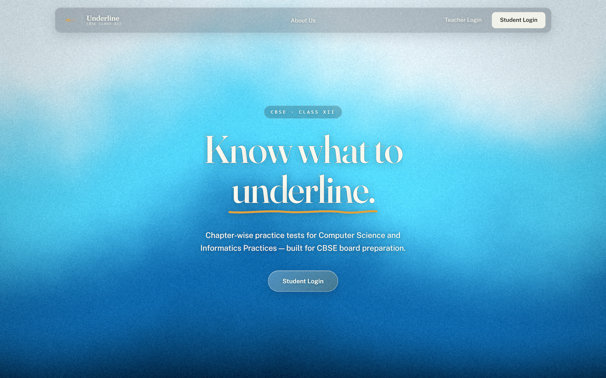
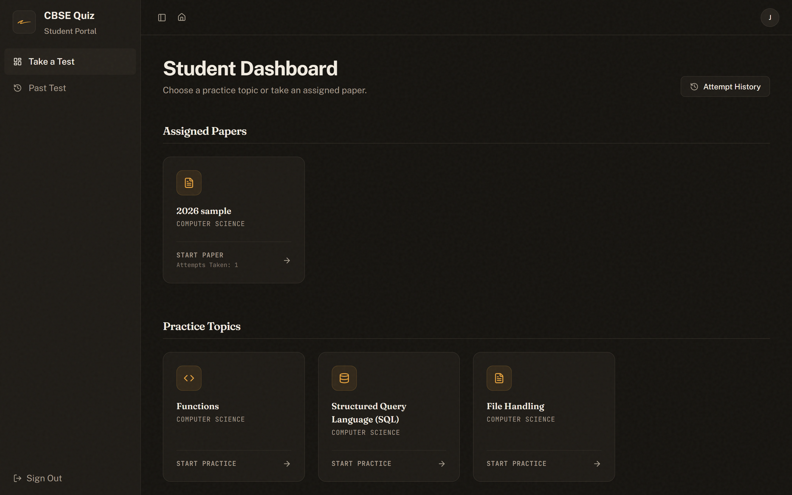
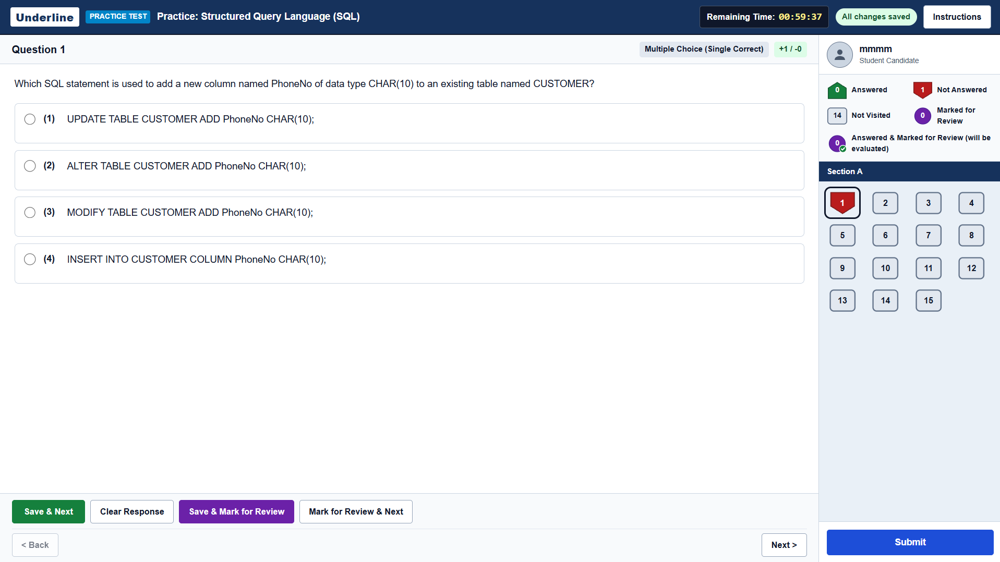
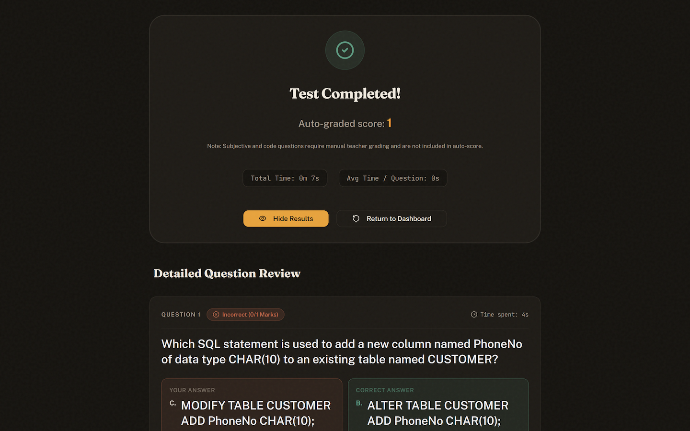
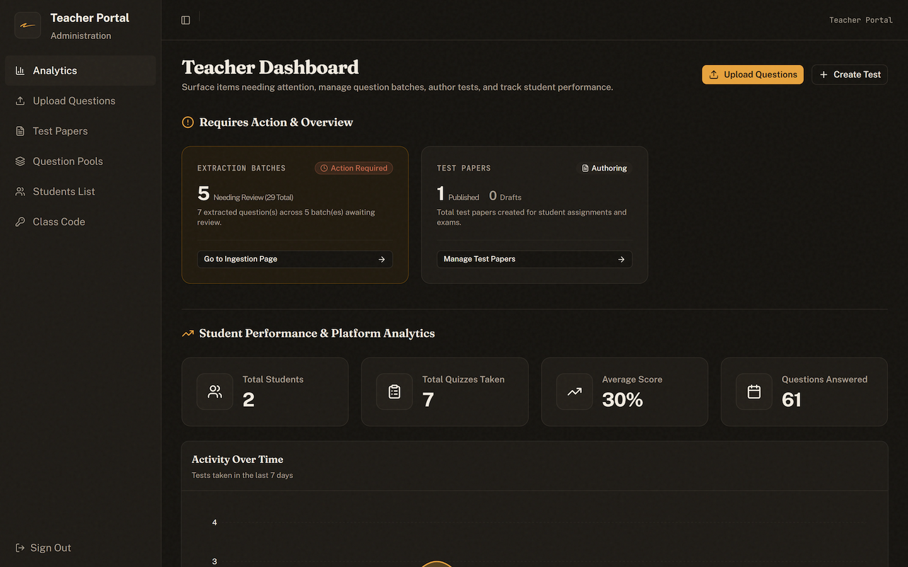
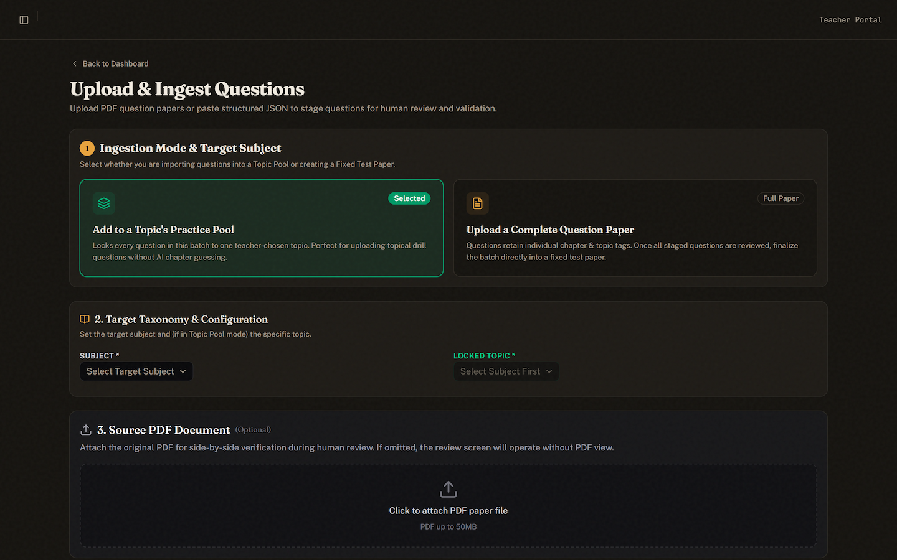
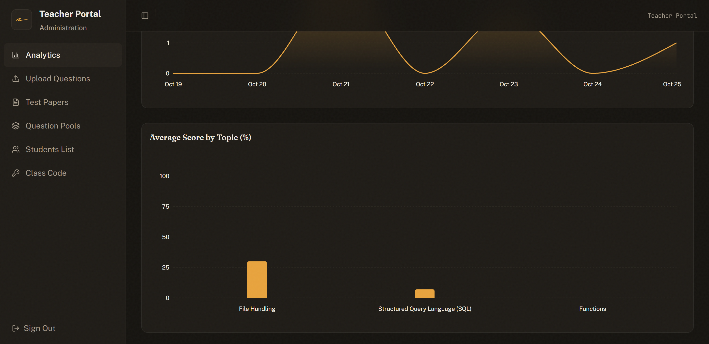
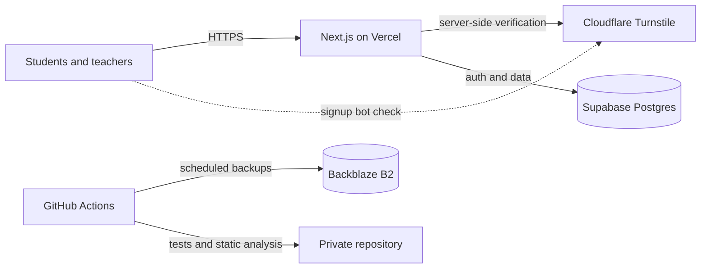

# Underline

> Chapter-wise board-exam practice for CBSE Class XII Computer Science (083) and Informatics Practices (065).

**Status:** Live and in active use · **Source code:** private · **Last updated:** October 2026

**Live site:** https://underline-live.vercel.app

## Overview

Underline is a practice platform that I designed, built and deployed on my own. Students take chapter-wise quizzes with instant feedback. Teachers build the question bank and assign tests. It is used at my school.

## Screenshots (v1, October 2026)

## Features

**For students**
- Chapter- and topic-wise quizzes for Computer Science and Informatics Practices
- Instant feedback and a results view for each attempt
- An exam-style test interface
- A dashboard showing progress and attempt history

**For teachers**
- A question bank organised by chapters, topics and tags, supporting options, tables and grouped case-based questions
- Question ingestion from PDF papers or structured JSON, with extracted questions staged for teacher review before entering the bank
- Creating tests, assigning them to students and viewing analytics
- Class-code-based student signup and a view of enrolled students

**Platform**
- Separate student and teacher experiences with role-based access
- Password and Google sign-in
- Desktop-first design with responsive layouts for smaller screens

## Tech stack

| Area | Technology |
|---|---|
| Frontend | Next.js (App Router), React, TypeScript, Tailwind CSS, GSAP, Lenis, Three.js |
| Data and auth | Supabase (Postgres, Auth), Drizzle ORM |
| Hosting and CI | Vercel, GitHub Actions |
| Security | Cloudflare Turnstile, Postgres row-level security |
| Backups | Backblaze B2 |
| Testing and quality | Playwright, axe-core, Semgrep |

## Architecture

## Engineering highlights

- Access control enforced on the server at the request boundary, not only in the UI
- Row-level security enabled across the database tables
- Bot protection with server-side verification on signup
- Automated Playwright tests covering protected routes, sessions and redirect behaviour
- Static analysis with Semgrep as a CI gate
- Accessibility checks with axe-core as part of testing
- Scheduled database backups to object storage
- A landing page with GSAP scroll animations and a custom WebGL shader

## What I learned

- Putting authorization at the request boundary instead of scattering checks across pages
- Treating incoming question data as untrusted input: staging it for human review before it reaches the question bank
- Designing a test-taking experience that feels like a real exam
- Shipping to real users: environment configuration, preview deployments and rollbacks

## Roadmap

Version 1 (October 2026) is shown above. The interface and features will keep evolving, and newer screenshots will be added here as versions. A proper mobile layout is under development.

## Source code

The source code is private. If you would like a walkthrough, or a time-limited read-only review, contact me through my GitHub profile: https://github.com/SayanPal2009

## License

All rights reserved. © 2026 Sayan Pal

## Author

Built by Sayan Pal, student developer. GitHub: [@SayanPal2009](https://github.com/SayanPal2009)
